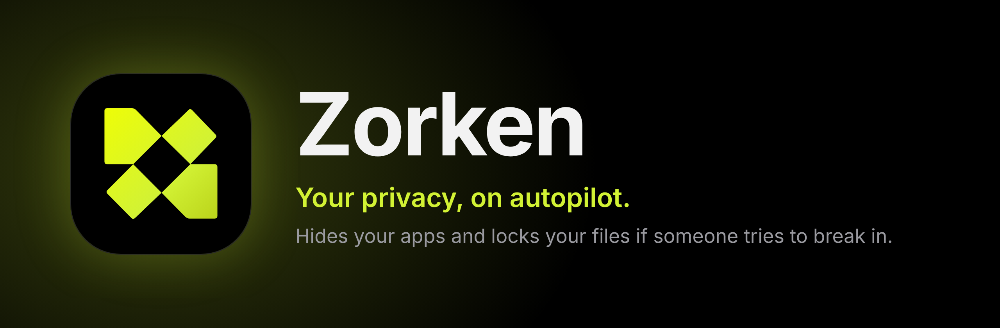
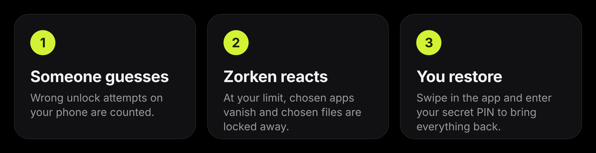

  

  
  
  
  

## What is Zorken?

Zorken protects your private apps and files from people who get hold of your phone.

You choose how many wrong unlock attempts are allowed. If someone goes over the limit, Zorken **hides your chosen apps** and **locks your chosen folders and files in an encrypted vault**. Only you can bring them back, with your secret PIN inside the app.

  

## Features

| | |
|---|---|
| **Hide apps** | Pick any apps. They disappear from your phone when the limit is reached. |
| **Lock files and folders** | Chosen items are moved into a hidden vault and encrypted. |
| **Secret PIN** | A separate PIN, different from your phone lock, is the only way to restore. |
| **Safe by design** | A correct phone unlock never restores anything. Hiding needs no PIN, restoring does. |
| **Your limit** | Choose 1 to 10 wrong attempts before Zorken acts. |
| **Swipe to hide or restore** | One swipe, with live progress in the app and in a notification. |
| **Hide the app icon** | Remove Zorken from your launcher, and open it from LSPosed when you need it. |
| **Survives reinstall** | Your settings are kept, so updating or reinstalling is painless. |

## Get started

1. **Download** the APK from [Releases](https://github.com/syedtahseen/zorken/releases/tag/latest) and install it.
2. Open **LSPosed**, enable the **Zorken** module with scope **System Framework**, then **reboot**.
3. Open Zorken and **create your PIN**.
4. Choose your **apps** and **folders or files**, and set your **wrong attempts** limit.
5. Allow **All files access** and **notifications** when asked.

Tip: turn off battery optimization for Zorken so locking is never interrupted.

## Good to know

- **There is no PIN recovery.** Files that are already locked cannot be opened without your PIN, so remember it.
- **Something wrong?** The status card on the home screen tells you what to fix, and the **Logs** section shows what happened.
- **App icon hidden?** Open Zorken from LSPosed, then Modules, then Zorken.
- **After an update,** reboot once if the status card says the module is an older version.

## Found a bug?

Open the menu in the app and tap **Bug report**, or [create an issue](https://github.com/syedtahseen/zorken/issues/new).
